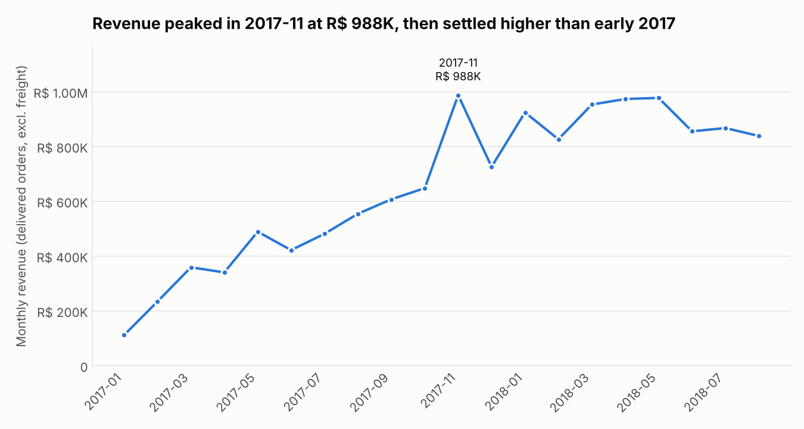
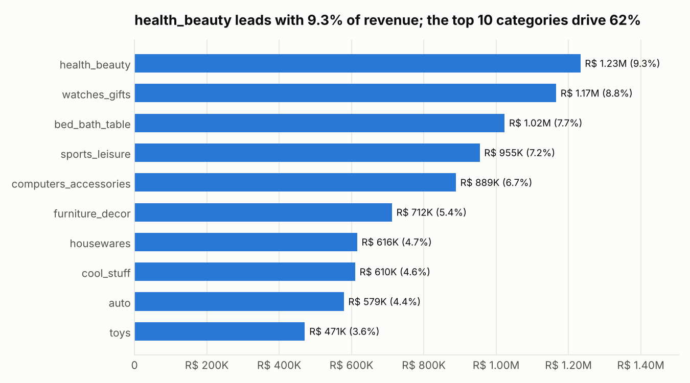
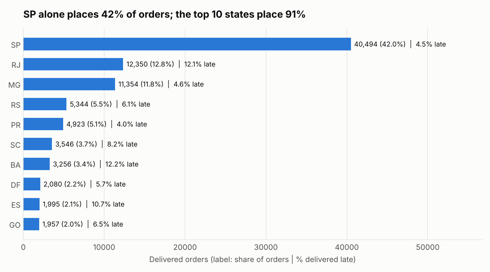
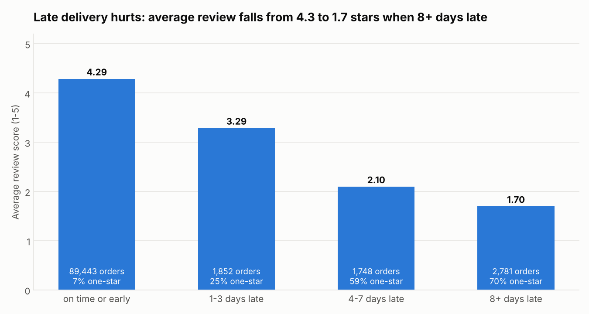
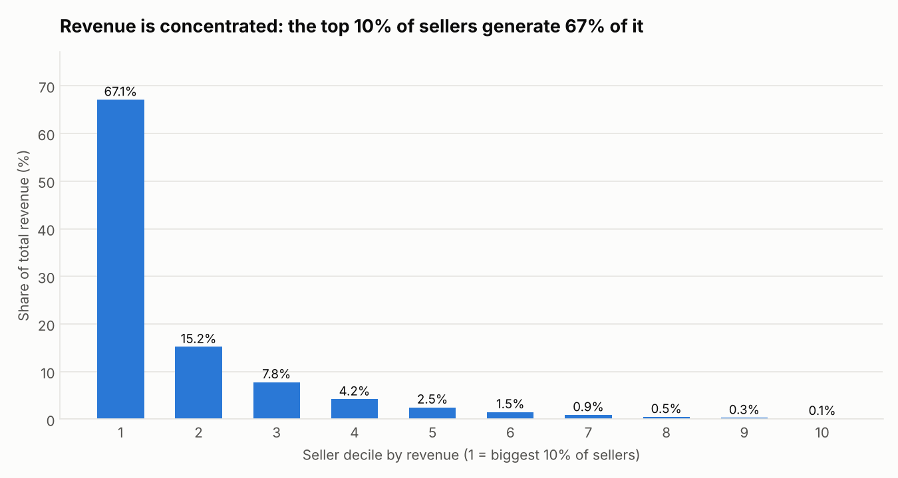

# Analisis E-Commerce Olist: di mana bisnisnya sehat, dan di mana bocornya?

Proyek portofolio data analyst yang dibuat dari **Brazilian E-Commerce Public Dataset by Olist**
([Kaggle](https://www.kaggle.com/datasets/olistbr/brazilian-ecommerce), sekitar 100 ribu order, 2016-2018).

**Skenario.**marketplace yang menghubungkan penjual kecil di Brasil
dengan pelanggan. Manajemen bertanya: *bagaimana kondisi bisnis kita, dan apa yang harus diperbaiki lebih dulu?*

**Tools.** SQL (SQLite) untuk analisis, Python (pandas, matplotlib) untuk memuat data, cross-check, dan grafik.

## Temuan utama

| # | Temuan | Bukti |
|---|--------|-------|
| 1 | Revenue naik sekitar 9x dari Januari ke November 2017, lalu **mendatar** di 2018 | Revenue bulanan: R$ 112K (Jan 2017) -> puncak R$ 988K (Nov 2017) -> R$ 838K (Agu 2018) |
| 2 | **97% pelanggan hanya membeli sekali** | 90.549 dari 93.350 pelanggan hanya punya satu order |
| 3 | **Pengiriman telat menghancurkan kepuasan pelanggan** | Rata-rata review 4,29 jika tepat waktu vs 1,70 jika telat 8+ hari (70% bintang satu) |
| 4 | Pengiriman adalah **masalah geografi** | São Paulo (SP): 8,8 hari, 4,5% telat. Negara bagian terpencil seperti AL, MA, AM, RR: 22-29 hari dan/atau 17-21% telat |
| 5 | Revenue bergantung pada **sedikit seller** | 10% seller teratas = 67% revenue; 20% teratas = 82% |
| 6 | Pelanggan membayar dengan **kartu kredit dan cicilan** | 78,5% dari nilai pembayaran, rata-rata 3,5 cicilan |

Secara keseluruhan: 96.470 order terkirim, **revenue R$ 13,2 juta** (harga item, tidak termasuk ongkir),
nilai order rata-rata R$ 137, ongkir = 16,6% dari revenue, rata-rata waktu kirim 12,6 hari,
6,8% order terkirim telat.

## Struktur proyek

```
olist-project/
├── README.md
├── analysis.py              # menjalankan semuanya dari awal sampai akhir (versi skrip)
├── notebooks/
│   └── olist_analysis.ipynb # analisis yang sama, sudah dijalankan, grafik tertanam
├── sql/
│   └── queries.sql          # 11 query terdokumentasi, masing-masing satu pertanyaan bisnis
├── outputs/
│   ├── tables/              # hasil setiap query dalam CSV
│   └── charts/              # 5 grafik (PNG)
├── data/raw/                # taruh CSV dari Kaggle di sini (tidak di-commit)
└── requirements.txt
```

## Cara menjalankan

1. Unduh dataset dari Kaggle dan taruh file CSV di `data/raw/` (file `geolocation` tidak dipakai).
2. `pip install -r requirements.txt`
3. `python analysis.py` (sekitar 20 detik). Tabel masuk ke `outputs/tables/`, grafik ke `outputs/charts/`.

Skrip ini juga melakukan **cross-check** jumlah order terkirim, revenue, persentase telat, dan persentase
pelanggan repeat antara SQL dan pandas, lalu berhenti dengan error kalau hasilnya berbeda.

## Analisis

### 1. Apakah bisnisnya tumbuh?



Revenue naik stabil sepanjang 2017, melonjak 52% dibanding bulan sebelumnya pada November 2017
(kemungkinan karena Black Friday, tapi ini belum aku verifikasi di data), lalu bergerak mendatar
di kisaran R$ 826K-978K per bulan pada 2018. Nilai order rata-rata tetap di rentang sempit R$ 124-149,
jadi pertumbuhan berasal dari **jumlah order, bukan keranjang yang lebih besar**.
Sejak Mei 2018 revenue cenderung turun (R$ 978K -> R$ 838K pada Agustus), dan ini perlu dipantau.

Grafik hanya menampilkan 2017-01 sampai 2018-08: tahun 2016 hanya punya segelintir order dan akhir 2018 belum lengkap.

### 2. Apa yang laku?



`health_beauty`, `watches_gifts`, dan `bed_bath_table` memimpin; 10 kategori teratas menyumbang 62% revenue.
Tiap kategori menang dengan cara berbeda: `bed_bath_table` menjual item terbanyak (10.953) dengan harga murah
(R$ 93), sedangkan `watches_gifts` menghasilkan lebih banyak dari item yang jumlahnya sekitar setengahnya,
dengan harga R$ 199 per item.

### 3. Di mana pelanggannya, dan apakah jarak berpengaruh?



SP menyumbang 42% dari semua order dan paketnya sampai dalam 8,8 hari. Wilayah utara dan timur laut menunggu
jauh lebih lama (misalnya PA 23,8 hari, AM 26,4, RR 29,4) dan membayar ongkir lebih mahal: ongkir sebesar 13,9%
dari revenue di SP, tetapi 24-28% di beberapa negara bagian terpencil (MA, RR, AM, RO).
Tabel lengkap: `outputs/tables/q04_state_summary.csv`.

### 4. Apakah telat kirim benar-benar berpengaruh?



Ini sinyal terkuat di data. Telat **1-3 hari** saja sudah menurunkan rata-rata review dari 4,29 ke 3,29 dan
melipatgandakan review bintang satu hampir empat kali (6,6% -> 25,1%). Hanya 6,8% order yang telat, tetapi
mereka menghasilkan porsi review jelek yang tidak sebanding.
*Ini korelasi, bukan bukti sebab-akibat: order yang telat bisa juga berbeda dalam produk, seller, atau wilayah.*

### 5. Apakah pelanggan kembali lagi?

97,0% pelanggan hanya punya satu order, 2,8% dua order, dan hanya 0,2% tiga order atau lebih.
Kalau memakai `customer_id` alih-alih `customer_unique_id`, 3.345 pembeli repeat akan tersembunyi dan retensi
terlihat lebih buruk lagi. Ini jebakan klasik di dataset ini.

### 6. Seberapa terkonsentrasi basis seller?



Desil teratas (297 seller) menghasilkan 67,1% revenue; separuh seller terbawah digabung hanya menyumbang 3,3%.
Seller peringkat #5 berdasarkan revenue (`7c67e144...`, SP) menghasilkan R$ 187K tetapi rata-rata review-nya
3,35, yang terendah di antara 10 besar: akun besar dengan masalah kepuasan pelanggan.

## Keputusan data cleaning

Setiap keputusan ditulis di blok `setup` dalam `sql/queries.sql` dan didukung oleh `q11_data_quality_checks.csv`.

| Masalah yang ditemukan | Keputusan |
|------------------------|-----------|
| 2.963 order bukan berstatus `delivered` (shipped, canceled, unavailable, dll.) | Dikeluarkan dari metrik revenue dan pengiriman |
| 8 order `delivered` tidak punya tanggal sampai | Dikeluarkan (waktu kirim tidak bisa dihitung) |
| 775 order tidak punya item | Otomatis keluar lewat join dengan tabel item |
| 547 order punya lebih dari satu review | Ambil review **terbaru** per order |
| `customer_id` baru untuk setiap order | Pakai `customer_unique_id` untuk mengenali satu orang |
| 610 produk tanpa kategori; 2 kategori tidak ada di file terjemahan | Diberi label `unknown`; 2 terjemahan ditambahkan manual |
| 249 order dengan pembayaran berbeda dari item + ongkir lebih dari R$ 1 | Revenue dihitung dari harga item; data pembayaran hanya dipakai untuk komposisi metode bayar |
| 2016 dan akhir 2018 tidak lengkap | Tren bulanan dibatasi 2017-01 .. 2018-08 |
| "Telat" = sampai di tanggal kalender setelah tanggal estimasi | Sampai tepat di hari yang dijanjikan tidak dihitung telat |

## Rekomendasi

1. **Perbaiki pengiriman di negara bagian terpencil lebih dulu.** Negosiasikan SLA dengan kurir di sana, atau
   buat estimasi tanggal sampai yang lebih realistis: meleset 1-3 hari saja sudah menurunkan sekitar satu bintang.
2. **Bangun program retensi.** Dengan 97% pembeli sekali, kenaikan kecil pada pembelian ulang lebih berharga
   daripada akuisisi pelanggan baru. Uji voucher atau email setelah pengalaman pengiriman yang *baik*.
3. **Kelola konsentrasi seller.** Tunjuk account manager untuk desil teratas dan tinjau seller besar yang
   ratingnya rendah (seperti yang 3,35 di atas).
4. **Periksa ongkir tinggi di wilayah terpencil.** Ongkir di atas 24% dari revenue mungkin menurunkan konversi
   di sana (hipotesis yang perlu diuji, data ini tidak bisa membuktikannya).
5. **Cermati kategori dengan rating rendah** seperti `office_furniture` (rata-rata 3,52, terendah di antara
   kategori dengan 500+ order).

## Keterbatasan

- Data observasional 2016-2018: temuan menunjukkan hubungan, bukan sebab-akibat.
- Revenue berarti harga item saja; ongkir dianalisis terpisah.
- Teks review (bahasa Portugis) dan file geolocation tidak dipakai.
- Teks pada grafik berbahasa Inggris.

---

## Cara belajar dari proyek ini

1. **Jangan langsung baca hasilnya.** Baca satu pertanyaan di `sql/queries.sql`, tebak dulu jawabannya,
   lalu jalankan dan bandingkan.
2. **Tulis ulang querynya dari nol** tanpa melihat, mulai dari Q01 sampai Q06. Itu latihan JOIN, GROUP BY,
   CASE, dan window function (`LAG`, `NTILE`, `ROW_NUMBER`) yang sering keluar di interview.
3. **Pahami kenapa cleaning-nya begitu.** Coba ganti `customer_unique_id` jadi `customer_id` di Q07 dan lihat
   angkanya berubah.
4. **Tambahkan analisis sendiri**, misalnya:
   - Cohort retention per bulan pembelian pertama.
   - Segmentasi pelanggan RFM (recency, frequency, monetary).
   - Peta penjualan per state dengan file `geolocation`.
   - Analisis teks review berbahasa Portugis (kata apa yang muncul di review bintang 1?).
5. **Bikin dashboard** (Power BI / Tableau / Looker Studio) dari file di `outputs/tables/`. Portofolio
   yang punya dashboard dan rekomendasi bisnis biasanya lebih menonjol daripada notebook saja.
